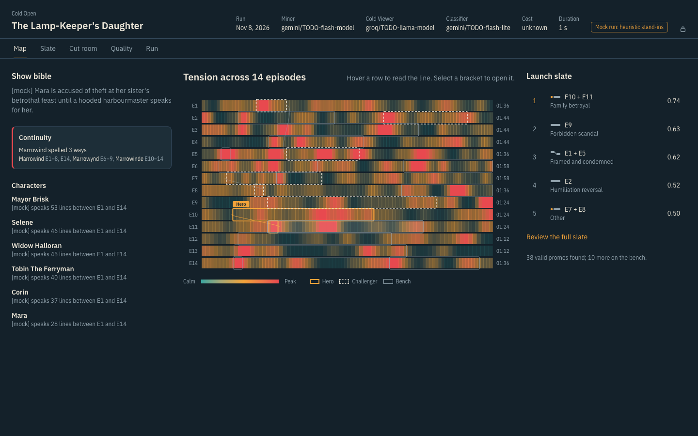
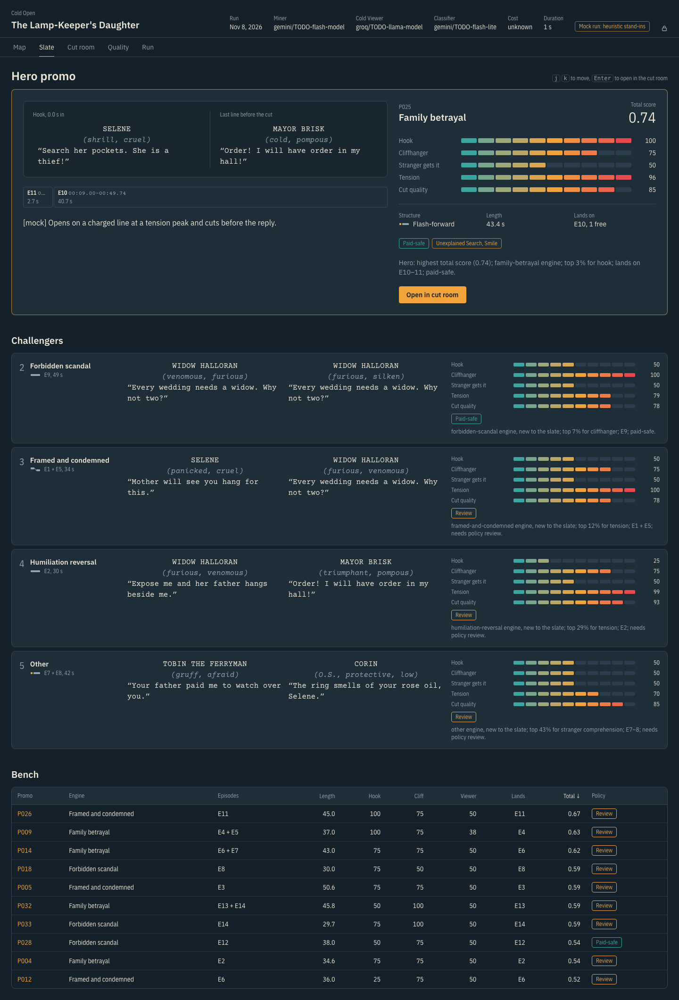
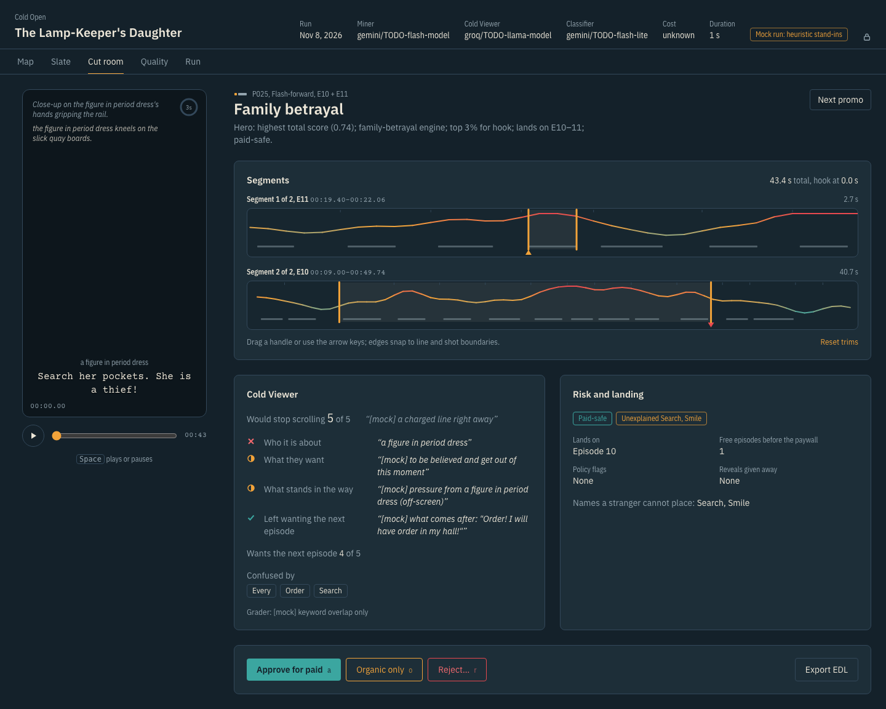
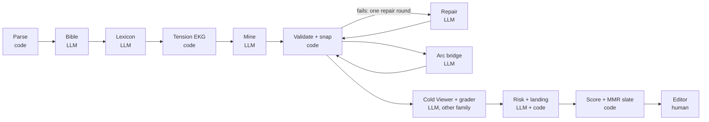

# Cold Open

Cold Open reads a microdrama screenplay (a folder of timestamped episode scripts) and returns a ranked
**launch slate** of promos: 20–60 second cuts that hook in the first 3 seconds, end on a cliffhanger and make
sense to a stranger. Editors review them in a web cutting room and export CMX3600 EDLs and a CSV cut list.

**AI judges meaning. Code owns facts. The editor makes the final call.** The model only ever names line IDs.
Code turns them into timecodes, enforces every hard rule and ranks. A person approves, trims or rejects.



<table><tr>
<td></td>
<td></td>
</tr></table>

Screenshots show *The Lamp-Keeper's Daughter*, an invented demo show (`examples/`), run with offline stand-in
models.

## Quick start

```bash
uv sync                                   # Python 3.11+
cp .env.example .env                      # add GEMINI_API_KEY (and GROQ_API_KEY for a second model family)
uv run coldopen models                    # model names your keys can use; paste them into config.yaml
uv run coldopen llm-ping                  # one tiny call per role: tokens, cost, latency

uv run coldopen run --input data/pack --out runs/demo --title "My show"
cd web && npm ci && npm run build && cd ..
uv run coldopen serve                     # http://127.0.0.1:7860
```

No keys yet? Run the whole pipeline offline with deterministic stand-ins:

```bash
uv run python scripts/make_demo_show.py "examples/The Lamp-Keeper's Daughter"
uv run coldopen run --input "examples/The Lamp-Keeper's Daughter" --out runs/demo-lamp --provider mock
```

`--input` takes a folder or a `.zip`. `--max-episodes 3` makes a quick test run. `--stages mine,snap` recomputes only
those stages and loads the rest from the run folder.

## How it works



| Stage | Who | What it does |
|---|---|---|
| Parse | code | Every timed block becomes an atom with an ID (`E01.042`). Fails loudly with file, line and what was expected. |
| Bible | LLM | Characters with episode-scoped aliases, arcs, reveals, and which code-detected spelling drifts are truly one entity. |
| Lexicon | LLM | Arousal and valence for each free-text delivery tag; cached per model across shows. |
| Tension EKG | code | Per-second loudness from tags, punctuation, violent verbs, sound and camera cues. Cheap recall, blind to meaning. |
| Mine | LLM | 3–6 candidates per episode by atom ID, including one quiet line away from the loud peaks; then cross-episode arc bridges. |
| Validate | code | IDs, hook within 3 s, 20–60 s, no cut through a spoken line, verbatim quotes, snapping to shot changes, dedupe, continuity warnings. One LLM repair round, then a reason-coded rejection. |
| Cold Viewer | LLM (judge) | Sees only what a scroller sees: faces described, never named. Would it stop? What did it understand? A grader checks that against the bible. |
| Risk | LLM + code | Ad-policy level and evidence, reveals given away, landing episode and free runway before the paywall. |
| Slate | code | Transparent weighted score minus penalties; MMR picks a hero and challengers that differ in engine, episodes and footage. |

Outputs per run (`runs/<name>/`): every LLM call (`llm_calls/`), each stage's artifact (`00_` … `08_`), `promos.csv`,
`promos.md`, `edl/*.edl`, `run_report.json` (tokens, cost, stage timings, counts, constraint pass rates) and
`decisions.jsonl` from the UI.

## Swapping models

Models are chosen per **role** in `config.yaml`. Changing one is a one-line edit with no code change:

```yaml
models:
  miner: "gemini/<model>"        # bible, mining, repair
  judge: "groq/<model>"          # the Cold Viewer: a different family on purpose
  classifier: "gemini/<model>"   # lexicon, grader, risk
```

Prices go in `prices.yaml` (USD per million tokens, from each provider's pricing page). An unknown price gives
`cost: null`, never a guess. `--provider replay` re-runs from the response cache with no network, which reproduces
a recorded run exactly. On a slow free tier, `judge_limit: 40` judges only the top 40 valid promos.

## Evaluation

1. Write `eval/gold.yaml` by hand (about 15 promos you would cut), using `coldopen show E01` to read timecodes:
   ```yaml
   - id: G01
     episode: 1
     start: "00:33.0"
     end: "01:05.0"
     note: "what happens"
   ```
2. `uv run coldopen ablate --input data/pack --out runs/ablate` runs four variants: `rules` (no LLM), `llm_only`
   (the model writes timestamps, nothing checks them), `no_viewer` and `full`.
3. `uv run coldopen eval --run runs/ablate/full --ablate runs/ablate --rate` asks for blind 1–5 ratings of the top 10
   and a Cold Viewer audit, then writes `eval/eval_report.{json,md}`: hit rate, cut error, precision@10, constraint
   pass rates, rejection reasons, ablation table and a failure gallery.
4. `uv run coldopen doc --run runs/ablate/full` renders the 2-page solution PDF from those numbers.
   `uv run coldopen bundle --run runs/ablate/full` zips the raw outputs.

## Review UI

| Screen | For |
|---|---|
| Map | Tension across every episode, with the slate's brackets on top. Hover to read the line; select a bracket to open it. |
| Slate | Hero spread (screenplay-set hook and cliffhanger, VU-meter scores, rationale), challengers, sortable bench. Keys `j` `k` `Enter`. |
| Cut room | Real-time 9:16 phone animatic with a 3-second hook ring, trim handles that snap to line and shot boundaries and re-validate live, Cold Viewer answers, risk, and decisions (`a` approve, `o` organic, `r` reject). EDL export includes trims. |
| Quality | Candidate funnel, results ledger, overlap with gold, ablations as small multiples, failure gallery. |
| Run | Upload a zip, pick models, use your own key (never stored), watch stages stream in. |

Accessibility: keyboard reachable throughout, visible focus, reduced-motion support, WCAG AA contrast in both themes
(checked with axe-core on every screen).

## Deploying (Hugging Face Space, Docker)

The image builds the UI, installs the package and serves both on port 7860.

1. Create a **Docker** Space. Its `README.md` needs this header:
   ```yaml
   ---
   title: Cold Open
   sdk: docker
   app_port: 7860
   ---
   ```
2. Push this repository's tracked files to the Space (never `data/` or `runs/`; both are git-ignored).
3. Set Space secrets: `GEMINI_API_KEY`, optionally `GROQ_API_KEY`, and `DEMO_ACCESS_CODE`.
4. Demo runs stay private. Zip the run folder(s) (`cd runs && zip -r runs.zip final`), upload the zip to a **private**
   Hugging Face dataset, and set `DEMO_RUNS_URL` to its `resolve/main/runs.zip` link plus `HF_TOKEN` (read access).
   `scripts/fetch_demo.py` downloads it at start; viewing still needs the access code.

Locally: `docker build -t coldopen . && docker run -p 7860:7860 -e DEMO_ACCESS_CODE=... -v $PWD/runs:/data/runs coldopen`.

## Confidentiality

The input pack belongs to the client. `data/`, `runs/`, `.cache/`, the filled solution doc and the master prompt are
git-ignored. `scripts/check_leaks.py` runs as a pre-commit hook and blocks any staged file sharing four or more
consecutive words with a script line. Tests that need the pack are marked `@pytest.mark.pack` and skip without it.
Public tests use an invented 3-episode show in `tests/fixtures/`.

## Development

```bash
uv run pytest                       # unit, pipeline, API and eval tests
cd web && npm run dev               # UI with hot reload, proxied to the API on :7860
uv run python scripts/screens.py RUN_ID OUT_DIR --code CODE   # screenshots at 1440x900 and 390x844
```

`docs/BUILD_LOG.md` records every place generated work was wrong, how it was caught and the fix.

## Limitations

- Text only: cuts follow the script's camera notes, not the real edit, and nothing checks faces or audio.
- The tension signal is loudness. A hearth "fire" scores as violence; meaning comes from the LLM stages.
- Comprehension is judged by a model playing a stranger. The human audit in `coldopen eval --rate` measures how far
  to trust it.
- Costume and location contradictions across an arc bridge are not detected; only spelling drift is.
- Score weights are hand-set defaults, not learned from ad results.

## License

MIT.
